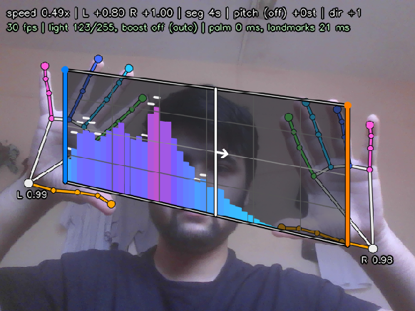

# AudioGesture

<a href="https://github.com/Harshit-Dhanwalkar/QMC/actions/workflows/ci.yml">
  
</a>

<div align="center">
  
</div>

Hold sound between your hands. A webcam tracks both hands with a 21-joint skeleton and audio spectrum is drawn inside shape your hands make; stretch, squash, tilt or flip that shape and audio follows (granular time-stretch, per-edge amplitude, phase inversion, reverse).

```
   left hand                                     right hand
      |-------------------------------------------|
      |  ▂▃▅▇█▇▅▃▂▁   spectrum bars, warped by    |      pull apart  -> slower
      |  grid: shorter edge = shorter bars        |      push closer -> faster
      |-------------------------------------------|      fist / tilt -> trapezium / triangle
```


## Gestures

| Gesture                                         | Effect                                                                                                                                                              |
| ----------------------------------------------- | ------------------------------------------------------------------------------------------------------------------------------------------------------------------- |
| Distance between hands                          | Length of grid = playback speed. Pull apart = slower, push together = faster (`speed = restLength / length`, 0.25x-4x)                                              |
| Height of each hand (wrist to middle fingertip) | Amplitude at that end of grid. Open hand = loud, fist = silent. Different heights give a trapezium, a fist gives a triangle; gain slides linearly between two edges |
| A hand upside down                              | That edge goes negative: bars hang from top and audio is phase-inverted. One flipped hand twists grid through zero                                                  |
| Sweep both hands sideways, fast                 | Latch reverse / forward (pulling apart is ignored, only a pure sweep counts)                                                                                        |
| Mean height of both hands (key `p`)             | Pitch +-12 semitones (off by default)                                                                                                                               |

Grid is drawn from same numbers audio engine receives.
The white playhead shows where read head is inside current 4-second segment, i.e. where engine is sampling gain ramp.
There is no decorative waveform: every pixel is either grid or measured audio (spectrum of signal leaving speakers, so stretch/pitch/reverse show up).

## Keys

| Key       | Action                                                           |
| --------- | ---------------------------------------------------------------- |
| `c`       | Calibrate: pose holded becomes 1x speed and full amplitude |
| `s`       | Segment length held between hands: 1 / 2 / 4 / 8 s               |
| `v`       | Bars <-> mirrored bars                                           |
| `p`       | Pitch from hand height on/off                                    |
| `l`       | Low-light boost: auto -> on -> off                               |
| `t`       | Temporal denoise (part of boost) on/off                          |
| `d`       | Show tracker's search windows                                    |
| `q` / Esc | Quit                                                             |

## Build and run

```sh
sudo apt install build-essential cmake pkg-config libopencv-dev portaudio19-dev libsndfile1-dev
pip install onnx                  # only if your OpenCV is older than 4.7 (pkg-config --modversion opencv4)

make models                       # one-off: ~8 MB of MediaPipe models into models/
make                              # configure + build  -> build/audiogesture
make run AUDIO=audio/file_example_WAV_2MG.wav        # or: build/audiogesture file.wav [camera | video]
```

`make help` lists everything (`clean`, `distclean`, `rebuild`, `probe`, `test`, `test-asan`).
Without models app says so and falls back to old skin-colour tracker (`--skin` forces it).
MP3 needs libsndfile >= 1.1; otherwise convert to WAV.

## Tests

```sh
make test          # unit tests; test_tracker is skipped unless models are downloaded
make test-asan     # same under AddressSanitizer + UBSan
```

| Test                | Checks                                                                                                                                                                   |
| ------------------- | ------------------------------------------------------------------------------------------------------------------------------------------------------------------------ |
| `test_audio_engine` | gain ramp 0->1 gets louder across the segment, -1 is the exact phase inverse of +1, stretch 2 halves the head speed, reverse wraps backwards                             |
| `test_mapper`       | distance -> stretch, edge heights -> signed gains (rectangle, fist, upside-down, twist), single hand holds values, sweep vs stretch, calibrate, pitch                    |
| `test_spectrum`     | a sine lands in the right log-spaced bar, silence decays                                                                                                                 |
| `test_enhancer`     | dark frames get brighter, bright ones untouched, denoise lowers noise without smearing a moving block                                                                    |
| `test_grid`         | bars stay inside the trapezium / triangle / inverted / twisted quad                                                                                                      |
| `test_tracker`      | models load on this OpenCV, no phantom hands on black or noise frames; if `tests/data/hand.jpg` exists a real hand must be found |

## How tracker works

Two small MediaPipe networks run through `cv::dnn` (no extra runtime):

1. **Palm detector** (192x192 SSD) finds palms anywhere in frame.
2. **Hand landmark model** (224x224) regresses 21 joints in a rotated crop around one hand and reports a
   presence score (`Identity_1`; `Identity_2` is handedness and must not be used as presence).

Joints from frame N define crop for frame N+1, so palm detector only runs when a hand is missing;
a One-Euro filter smooths joints. Left/right is by screen position in mirrored view (further left on screen = left hand) and each hand keeps its slot afterwards.

### Tuning

| What                                                         | Where                                                              |
| ------------------------------------------------------------ | ------------------------------------------------------------------ |
| Palm / presence thresholds, scan fallback, smoothing         | `HandTrackerConfig` in `include/audiogesture/vision/HandTracker.h` |
| Low-light levels, blur, denoise strength                     | `LowLightEnhancer.h`                                               |
| Speed range, amplitude reference, deadzone, sweep thresholds | `src/control/GestureMapper.cpp`                                    |
| Grain size / smoothing time constants                        | `src/audio/AudioEngine.cpp`                                        |
| Bars, range, gravity, monstercat                             | `SpectrumAnalyzer::Config`                                         |

### Debugging

```sh
HAND_DEBUG=1 build/audiogesture file.wav 2>&1 | grep -E '\[palm\]|\[lm\]|\[scan\]'
build/hand_probe photo.jpg --dark 0.15 --noise 6 --lowlight --out dark.png     # simulate a dim room
build/hand_probe photo.jpg --dark 0.1 --noise 7 --lowlight --jitter 3 --trials 30   # cold-start success rate
build/audiogesture file.wav clip.mp4 --snapshot out.png   # headless: save composed view after 40 frames
```

## OpenCV versions

Works with OpenCV >= 4.5 (tested on 4.5.4 and 4.6). Stock landmark model uses ONNX operators that
OpenCV < 4.7 cannot parse; `make models` also writes `*_cvcompat.onnx` (needs `pip install onnx`) via
`models/make_opencv_compat.py`, and app picks right file itself. Outputs are requested by name,
so order OpenCV happens to return them in does not matter.

Models: MediaPipe Hands, Apache-2.0, as packaged by [opencv_zoo](https://github.com/opencv/opencv_zoo).
