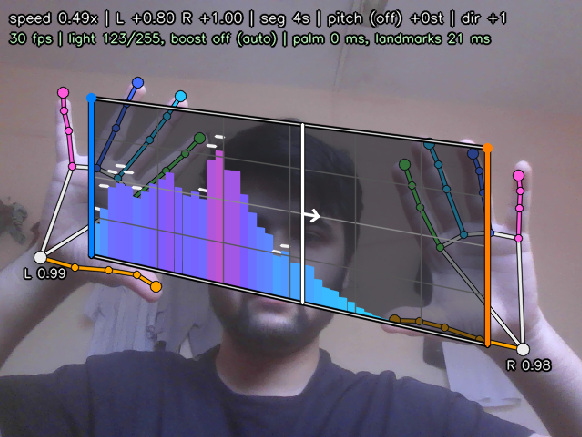

# AudioGesture

<a href="https://github.com/Harshit-Dhanwalkar/AudioGesture/actions/workflows/ci.yml">
  
</a>

<div align="center">
  
</div>

AudioGesture is a real-time, C++ granular audio engine controlled entirely by your hands. A webcam tracks both hands with a 21-joint skeleton, and space between them becomes an elastic, interactive audio grid. Stretch, squash, tilt, or flip shape, and audio (and visualizer) follows instantly.

```
   left hand                                     right hand
      |-------------------------------------------|
      |  ▂▃▅▇█▇▅▃▂▁   spectrum bars, warped by    |      pull apart  -> slower
      |  grid: shorter edge = shorter bars        |      push closer -> faster
      |-------------------------------------------|      fist / tilt -> trapezium / triangle
```

## Gestures

| Gesture                                             | Effect                                                                                                                                                              |
| --------------------------------------------------- | ------------------------------------------------------------------------------------------------------------------------------------------------------------------- |
| Distance between hands                              | Length of grid = playback speed. Pull apart = slower, push together = faster (`speed = restLength / length`, 0.25x-4x)                                              |
| Height of each hand (wrist to middle fingertip)     | Amplitude at that end of grid. Open hand = loud, fist = silent. Different heights give a trapezium, a fist gives a triangle; gain slides linearly between two edges |
| A hand upside down                                  | That edge goes negative: bars hang from top and audio is phase-inverted. One flipped hand twists grid through zero                                                  |
| Sweep both hands sideways, fast                     | Latch reverse / forward (pulling apart is ignored, only a pure sweep counts)                                                                                        |
| Mean height of both hands (key `p`)                 | Pitch +-12 semitones (off by default)                                                                                                                               |
| Pinch thumb and index together (either hand)        | **Freeze**: read head stops and grains keep playing from that spot with a little random spray, a sustained pad. Release to resume.                                  |
| Turn the **left** palm edge-on to the camera (roll) | High-pass sweeps 20 Hz -> 1.2 kHz (thin out the bass)                                                                                                               |
| Turn the **right** palm edge-on (roll)              | Low-pass sweeps 20 kHz -> 400 Hz (muffle the highs)                                                                                                                 |

Grid is drawn from same numbers audio engine receives.
White playhead shows where read head is inside current 4-second segment, i.e. where engine is sampling gain ramp.
There is no decorative waveform: every pixel is either grid or measured audio (spectrum of signal leaving speakers, so stretch/pitch/reverse show up).

## OSC output
Sending **Open Sound Control** messages across a network using the **User Datagram Protocol** for real-time
communication.
`build/audiogesture song.wav --osc 9000` (or `--osc host:port`) publishes gestures as OSC over UDP, 30 times
a second (Pure Data, Max, SuperCollider, TouchDesigner or a MIDI bridge can react to your hands):

| Address                          | Value                                                    |
| -------------------------------- | -------------------------------------------------------- |
| `/audiogesture/speed`            | float, 1 = calibrated rest pose (below 1 = slower)       |
| `/audiogesture/direction`        | float, +1 forward ... -1 reverse                         |
| `/audiogesture/gain/left`, `/right` | float, signed edge gain, -1 .. +1 (negative = upside-down hand) |
| `/audiogesture/pitch`            | float, semitones (0 unless pitch mode `p` is on)         |
| `/audiogesture/freeze`           | int, 1 while a hand pinches                              |
| `/audiogesture/lowpass`, `/highpass` | float, cut-off in Hz (20000 / 20 = open)             |
| `/audiogesture/hands`            | int, hands tracked (0-2)                                 |
| `/audiogesture/left`, `/right`   | float x, float y, palm centre 0..1 (only while tracked)  |

MIDI is not built in; any OSC-to-MIDI bridge (for example `osc2midi` or a few lines in Pd) turns these into
CCs.

## Keys

| Key       | Action                                                     |
| --------- | ---------------------------------------------------------- |
| `c`       | Calibrate: hold both hands in your comfortable pose for 3 s (count restarts if a hand is lost); that pose becomes 1x speed and full amplitude. Press again to cancel |
| `h` / `?` | Help overlay (gestures and keys). Opens by itself until you have calibrated once |
| `s`       | Segment length held between hands: 1 / 2 / 4 / 8 s         |
| `v`       | Bars <-> mirrored bars                                     |
| `p`       | Pitch from hand height on/off                              |
| `e`       | Effects (pinch freeze + roll filters) on/off               |
| `l`       | Low-light boost: auto -> on -> off                         |
| `t`       | Temporal denoise (part of boost) on/off                    |
| `r`       | Start / stop recording what you hear to `recordings/*.wav` |
| `d`       | Show tracker's search windows                              |
| `q` / Esc | Quit                                                       |

## Recording, settings, drop-outs

- **Record (`r`, or `--record out.wav`)**: saves exactly what leaves speakers as a stereo 32-bit float
  WAV in `recordings/`. Audio thread only copies samples into a lock-free ring; a separate thread
  writes file, so recording can't glitch playback. A red `REC m:ss` badge shows while it runs.
- **Stereo is kept**: a stereo file plays in stereo (a mono file is centred).
- **Settings survive restarts**: your calibration (`c`), segment length, pitch, denoise, low-light mode
  and grid style are saved on quit to `~/.config/audiogesture/settings.ini` (`$XDG_CONFIG_HOME` is honoured).
  Plain `key = value` lines; bad values are ignored or clamped.
- **Short drop-outs are bridged**: if tracker loses a hand for less than 0.4 s, grid and audio stay
  where they were instead of flickering; after that grid hides and next sighting snaps into place.

The roll and pinch features are ratios against the hand's own palm length, so they do not depend on how
far you are from the camera (measured on a real open hand: pinch ratio 1.47, palm-width ratio 0.69; a pinch
is below 0.28, an edge-on palm about 0.1). Both are limited by 2-D landmarks: a hand turned *away* from the
camera looks like a hand turned edge-on, so keep the palm roughly facing the camera when you do not want a filter.


## Build and run

```sh
sudo apt install build-essential cmake pkg-config libopencv-dev portaudio19-dev libsndfile1-dev
pip install onnx                  # only if your OpenCV is older than 4.7 (pkg-config --modversion opencv4)

make models                       # one-off: ~8 MB of MediaPipe models into models/
make                              # configure + build  -> build/audiogesture
make run AUDIO=audio/file_example_WAV_2MG.wav        # or: build/audiogesture file.wav [camera | video]
```

`make help` lists everything (`clean`, `distclean`, `rebuild`, `probe`, `test`, `test-asan`).
Without models app says so and falls back to old skin-colour tracker (`--skin` forces it).

Camera capture, low-light enhancement and both neural-net passes run on a worker thread (`ThreadedHandSource`), so the
window, spectrum and audio control keep running at display rate while tracking takes 20-60 ms per frame; the HUD shows
both rates. `--sync` tracks on the UI thread instead (for debugging).

Left/right comes from the screen position (preview is a mirror) and once it has seen two clearly separated hands,
also from the model's handedness output: its polarity is learned, not assumed, so a hand that reaches across to
the other half of the picture or hands that cross keep their roles. Until that is learned it behaves as before.

MP3 needs libsndfile >= 1.1; otherwise convert to WAV.

## Tests

```sh
make test          # unit tests; test_tracker is skipped unless models are downloaded
make test-asan     # same under AddressSanitizer + UBSan
```

| Test                | Checks                                                                                                                                                |
| ------------------- | ----------------------------------------------------------------------------------------------------------------------------------------------------- |
| `test_audio_engine` | gain ramp 0->1 gets louder across segment, -1 is exact phase inverse of +1, stretch 2 halves head speed, reverse wraps backwards; freeze stops the head but not the sound; low-/high-pass remove the right tone |
| `test_biquad`       | Butterworth low-/high-pass: flat pass band, -3 dB at cutoff, > 30 dB down 3 octaves away, stable while cutoff sweeps |
| `test_mapper`       | distance -> stretch, edge heights -> signed gains (rectangle, fist, upside-down, twist), single hand holds values, sweep vs stretch, calibrate, pitch; pinch with hysteresis, roll -> cutoffs, effects off, no stuck freeze when a hand leaves |
| `test_spectrum`     | a sine lands in right log-spaced bar, silence decays                                                                                                  |
| `test_enhancer`     | dark frames get brighter, bright ones untouched, denoise lowers noise without smearing a moving block                                                 |
| `test_handedness`   | learns the model's polarity from separated hands (both conventions), settles crossed hands and a lone hand on the far side, ignores unsure or contradictory votes |
| `test_onboarding`   | calibration countdown (needs both hands, restarts, fires once), help text covers every key, overlays draw and survive tiny frames, file picker order zenity -> kdialog -> none |
| `test_osc`          | OSC wire format byte by byte, per-frame message set, `--osc` target parsing, real UDP round trip on loopback |
| `test_threaded`     | newest-wins hand-over between tracking and UI threads, frame/state stay paired, end of stream, clean shutdown (also run under TSan in CI) |
| `test_grid`         | bars stay inside trapezium / triangle / inverted / twisted quad                                                                                       |
| `test_recorder`     | recorded WAV equals what engine played, bit for bit; double start/stop and bad paths are safe                                                         |
| `test_settings`     | save/load round trip, clamping, garbage lines ignored                                                                                                 |
| `test_tracker`      | models load on this OpenCV, no phantom hands on black or noise frames; if `tests/data/hand.jpg` exists a real hand must be found                      |

## How tracker works

Two small MediaPipe networks run through `cv::dnn` (no extra runtime):

1. **Palm detector** (192x192 SSD) finds palms anywhere in frame.
2. **Hand landmark model** (224x224) regresses 21 joints in a rotated crop around one hand and reports a
   presence score (`Identity_1`; `Identity_2` is handedness and must not be used as presence).

Joints from frame N define crop for frame N+1, so palm detector only runs when a hand is missing;
a One-Euro filter smooths joints. Left/right is by screen position in mirrored view (further left on screen = left hand) and each hand keeps its slot afterwards.

### Tuning

| What                                                         | Where                                                              |
| ------------------------------------------------------------ | ------------------------------------------------------------------ |
| Palm / presence thresholds, scan fallback, smoothing         | `HandTrackerConfig` in `include/audiogesture/vision/HandTracker.h` |
| Low-light levels, blur, denoise strength                     | `LowLightEnhancer.h`                                               |
| Speed range, amplitude reference, deadzone, sweep thresholds | `src/control/GestureMapper.cpp`                                    |
| Grain size / smoothing time constants                        | `src/audio/AudioEngine.cpp`                                        |
| Bars, range, gravity, monstercat                             | `SpectrumAnalyzer::Config`                                         |

### Debugging

```sh
HAND_DEBUG=1 build/audiogesture file.wav 2>&1 | grep -E '\[palm\]|\[lm\]|\[scan\]'
build/hand_probe photo.jpg --dark 0.15 --noise 6 --lowlight --out dark.png          # simulate a dim room
build/hand_probe photo.jpg --dark 0.1 --noise 7 --lowlight --jitter 3 --trials 30   # cold-start success rate
build/audiogesture                                        # no file given: a file dialog (zenity/kdialog) opens
build/audiogesture file.wav clip.mp4 --snapshot out.png   # headless: save composed view after 40 frames
```

## OpenCV versions

Works with OpenCV >= 4.5 (tested on 4.5.4 and 4.6). Stock landmark model uses ONNX operators that
OpenCV < 4.7 cannot parse; `make models` also writes `*_cvcompat.onnx` (needs `pip install onnx`) via
`models/make_opencv_compat.py`, and app picks right file itself. Outputs are requested by name,
so order OpenCV happens to return them in does not matter.

Models: MediaPipe Hands, Apache-2.0, as packaged by [opencv_zoo](https://github.com/opencv/opencv_zoo).
